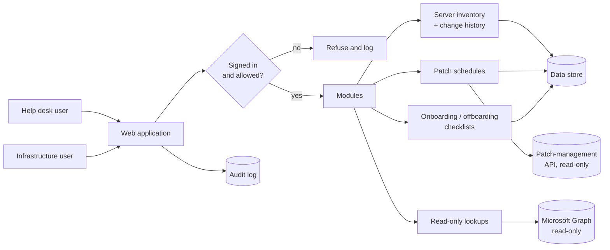

# 1. An internal web app that replaced spreadsheets

[← All case studies](README.md)

**Role:** designed and built it, with AI assistance for code drafts and tests  ·  **Scale:** about 300 servers and 7,000+ IP records  ·  **Status:** in use, still being extended
**Skills:** PHP · Microsoft Graph · Entra ID sign-in · access control · release process · automated testing  ·  **Reading time:** about 2 minutes

## Problem
Server inventory, patch schedules and onboarding and offboarding checklists lived in spreadsheets and separate documents. They drifted apart, and the help desk had to ask infrastructure for simple lookups: who has access to a SharePoint site, how full a mailbox is, why a OneDrive was unavailable.

## What I built
An internal web application in PHP, signed in with Entra ID, with two access levels (Help Desk and Infrastructure):
- **Server inventory** with a change history for every edit, and checks that flag when the inventory disagrees with other sources.
- **Patch schedule lists** per cycle, linked to the patching tool (Automox), so a server's group, pending updates and last installed updates are visible in one place.
- **Onboarding and offboarding checklists** with progress saved per person.
- **Read-only help-desk lookups** through Microsoft Graph. SharePoint access is live. Mailbox usage and OneDrive status are built and being validated on a test copy.
- **A release process:** a test copy first, then promotion to the live copy with a code backup, a syntax check and a rollback script.
- Automated browser and server tests for the main pages.

*Illustrative design showing how requests are checked and where data comes from. Not the actual deployed architecture.*

## Engineering decisions
| Decision | Why |
|---|---|
| Two access levels, checked on every request | Help desk sees only the lookups; changes stay with infrastructure |
| Help-desk lookups are read-only | They answer questions without creating a way to change anything |
| Test copy first, promote with a backup and a rollback script | A bad release can be undone quickly |
| Cache external data briefly (minutes) | Fewer calls to the other systems, without stale answers |

## Risk and validation
Each release is checked on a test copy, with automated tests, before it is promoted. Every lookup and change is written to an audit log. The inventory was reconciled against the original spreadsheet, and differences were corrected one by one.

## Result
- The inventory was reconciled against the old spreadsheet: roughly 300 servers and 7,000+ IP records matched.
- Help desk can look up SharePoint access without a ticket to infrastructure, and the same approach is being extended to mailbox and OneDrive questions.

## Limitations
Some pages and checks are still being finished. Mailbox archive detail and who-has-access for OneDrive need extra permissions that are not in place yet. Data from the patch tool is only as complete as that tool's own history, which is short for recently added servers and absent for Linux installs.

## What I'd improve
- Write the automated tests earlier; most were added after the features existed.
- Move to a framework with built-in input validation and migrations as the app grows beyond a few pages.
- Keep a short architecture note from day one, so another person can take it over.

*Last reviewed: November 2026*
