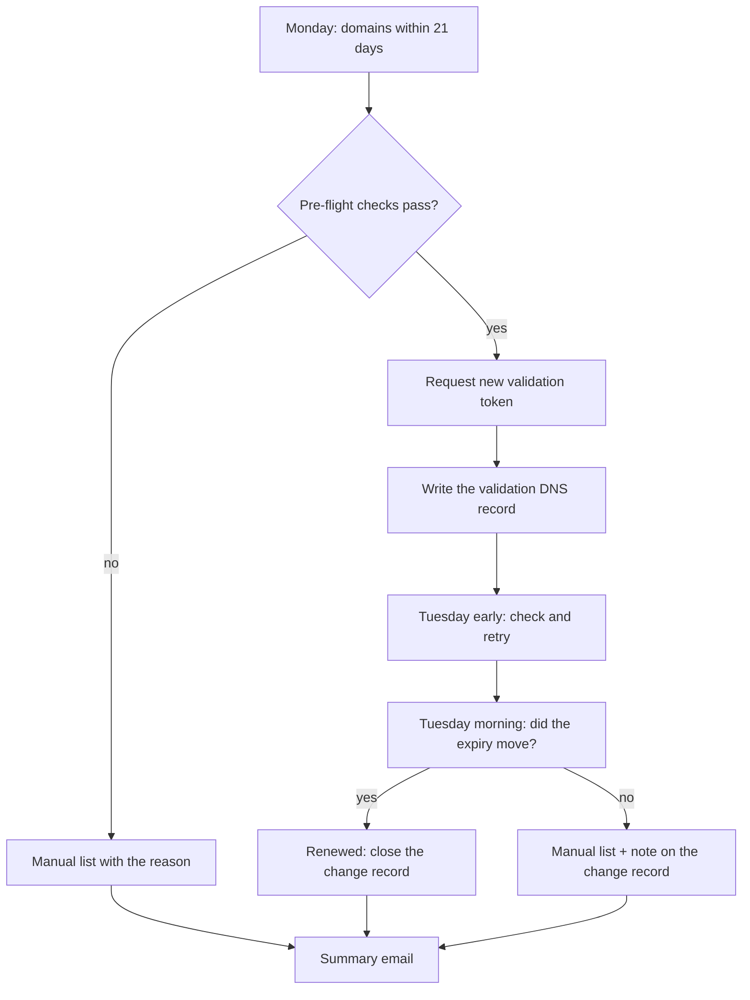

# 2. Automating Azure Front Door certificate renewal with Jenkins

[← All case studies](README.md)

**Role:** designed, built, tested and deployed it, with AI assistance for code drafts and test scenarios  ·  **Scale:** about 50 eligible domains  ·  **Status:** in production; first live run renewed two domains end to end

## Problem
Azure Front Door manages TLS certificates for custom domains, but for a domain at the root of a zone (an "apex" domain) it does not renew them by itself once the validation expires. Someone has to refresh the validation token and publish it as a DNS record before the certificate runs out. With dozens of domains on several Front Door profiles, that was a manual task that depended on someone remembering it, and a missed one means an expired certificate on a public site.

## What I built
A PowerShell script, run as a scheduled Jenkins job, that does the renewal in three steps across a week:

1. **Fix (Monday evening).** For each domain within 21 days of expiry, run pre-flight checks (the domain is a root domain in Azure DNS, it uses a managed certificate, the validation record already exists, nothing in the DNS blocks it). If they pass, ask Front Door for a new validation token and write it to the validation DNS record. If they don't, put the domain on a manual list and say why.
2. **Check (early Tuesday).** Retry anything that failed but is still fixable, and clean up a run that crashed part-way. It never emails.
3. **Final (Tuesday morning).** Treat a domain as renewed only if the certificate's expiry actually moved. Email a summary, list anything that needs a manual look with the token and current record to compare, and archive the run's state.

Around that:
- **Failures are contained.** One domain failing is recorded and the run carries on with the rest.
- **Dry-run mode** from the Jenkins build form, so any change to the script can be tried first.
- **A change record for every run.** It opens a pre-approved change in the ticketing system before the first renewal and closes it after the Tuesday check, with the result written in. If anything failed, it is left open with a note instead.
- **A separate read-only check** that lists domains whose permissions are missing, so a new domain does not fail silently later.

*Illustrative flow showing the order of checks and where a human is called in. Not a copy of the script.*

## Engineering decisions
| Decision | Why |
|---|---|
| Count a domain as renewed only when the certificate's expiry has moved | "The DNS record was written" is not the same as "it renewed" |
| Narrow, custom permissions: one role that can refresh the validation token, one that can write the validation record | The job's identity could not write role assignments, and it should not be able to do more than the task needs |
| Never touch the root DNS record set, only the validation record | The root record holds the mail and verification records; a mistake there affects far more than certificates |
| One failing domain does not stop the run | A single odd domain should not block the other renewals |
| A dry-run switch and an allow-list for the first runs | Prove it on real domains before widening it to all of them |
| Pre-approved change record created and closed automatically | The change process was kept, without someone having to open a ticket every week |
| A separate, read-only access check instead of letting the job grant itself access | The job can see what is missing but cannot widen its own permissions |

## Risk and validation
- Tested against a stand-in for Azure with 33 scenarios (a missing record, a failed write, a crash part-way, a retry), then in dry-run builds against the real environment.
- The first live run renewed two domains and moved their expiry about six months out. I checked the result in Azure itself, not only from the job's own email.
- The job signs in with a certificate, not a password, and its ticketing key is stored encrypted on the server so only the job's account can read it. That key can create and update change records but cannot look up people or act as a requester.
- Before each change to the live script, I copied the previous version aside and compared file hashes before and after the copy.

## Result
- The first live run renewed two domains end to end, verified in Azure.
- Renewal of the remaining eligible domains is now automatic as each enters the 21-day window. The access check confirmed the permissions were in place on the profiles in use.
- Every run leaves a change record and an emailed summary, which gives an audit trail that did not exist when renewals were manual.

## Limitations
- It only covers root domains that use managed certificates and whose DNS is in Azure DNS. Anything else lands on the manual list.
- It depends on a fixed list of Front Door profiles; a new profile needs the permissions added.
- The ticketing step uses one fixed requester and group, because the integration account is not allowed to look those up.
- The job cannot assign its own permissions, which is deliberate but means a person has to do that for a new profile.

## What I'd improve
- Send the alerts to a team channel as well as the mailbox.
- Make the permissions and the profile list part of a setup script that is easy to repeat for a new profile.
- Add a short runbook for what a person does with each kind of manual-list entry.

*Companion project: [certificate-expiry monitoring](04-certificate-expiry-monitoring.md) watches the certificates this job renews, and alerts if a renewal does not happen.*
