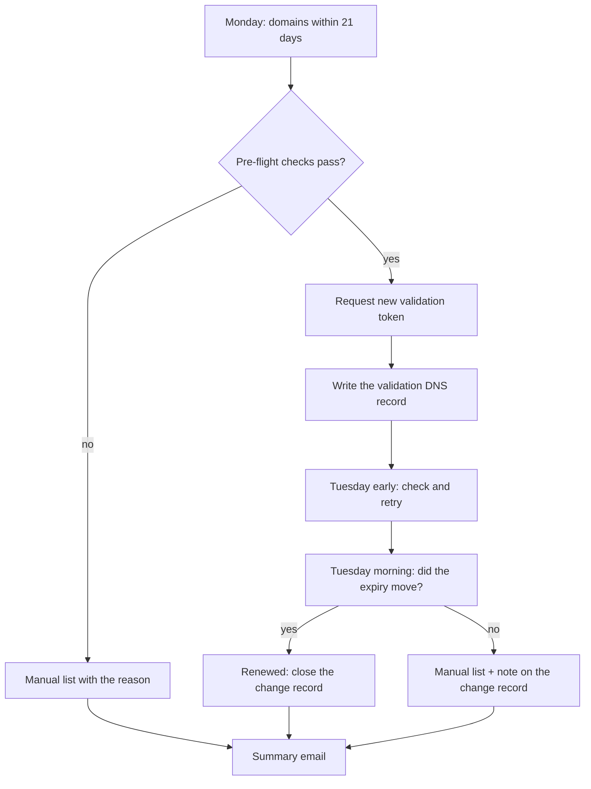

# 2. Automating Azure Front Door certificate renewal with Jenkins

[← All case studies](README.md)

**Role:** designed, built, tested and deployed it, with AI assistance for code drafts and test scenarios  ·  **Scale:** about 50 eligible domains  ·  **Status:** in production
**Skills:** PowerShell · Jenkins · Azure Front Door · Azure DNS · least-privilege RBAC · change management  ·  **Reading time:** about 3 minutes

## Problem
Azure Front Door does not renew the managed certificate on a root ("apex") domain by itself once its validation runs out. Someone has to refresh the validation token and publish it as a DNS record before the certificate expires. With dozens of domains across several profiles, that was a manual task that depended on someone remembering, and a miss means an expired certificate on a public site.

## What I built
A PowerShell script, run as a scheduled Jenkins job, that renews certificates in three steps across a week:

1. **Fix (Monday evening).** For each domain within 21 days of expiry, run pre-flight checks (root domain in Azure DNS, managed certificate, validation record already present). If they pass, request a new token and write it to the validation DNS record. If not, put the domain on a manual list with the reason.
2. **Check (early Tuesday).** Retry what failed but is still fixable, and clean up a run that crashed part-way.
3. **Final (Tuesday morning).** Count a domain as renewed only if the certificate's expiry actually moved. Email a summary and list anything that needs a person.

It also has a dry-run switch, keeps one failing domain from stopping the rest, opens and closes a pre-approved change record for each run, and has a separate read-only check that lists domains missing permissions.

*Illustrative flow showing the order of checks and where a person is called in. Not a copy of the script.*

## Engineering decisions
| Decision | Why |
|---|---|
| Renewed means the certificate's expiry moved | "The DNS record was written" does not prove it renewed |
| Narrow custom roles: one to refresh the token, one to write the validation record | The job's identity cannot assign roles, and should not be able to do more than the task needs |
| Only ever touch the validation record, never the root record set | The root set holds mail and verification records, so a mistake there reaches far beyond certificates |
| Dry run and an allow-list for the first runs | Prove it on real domains before widening it |
| Pre-approved change record opened and closed automatically | Keeps the change process without a ticket to raise every week |
| A separate read-only access check | The job can see what is missing but cannot widen its own permissions |

## Risk and validation
- 33 test scenarios against a stand-in for Azure (missing record, failed write, crash part-way, retry), then dry-run builds against the real environment.
- The job signs in with a certificate, not a password. Its ticketing key is encrypted on the server and readable only by the job's account, and it can create and update change records but cannot look up people.
- The first live run renewed two domains and moved their expiry about six months out. I verified that in Azure, not only from the job's own email.
- Each change to the live script was copied aside first, with file hashes compared before and after.

## Result
- The first live run renewed two domains end to end.
- Remaining eligible domains now renew automatically as each enters the 21-day window.
- Every run leaves a change record and an emailed summary, an audit trail that did not exist when renewal was manual.

## Limitations
- It covers only root domains with managed certificates whose DNS is in Azure DNS; anything else goes to the manual list.
- It works from a fixed list of profiles, so a new profile needs permissions added by a person. That is deliberate.
- The ticketing step uses one fixed requester and group, because the integration account cannot look those up.

## What I'd improve
- Send alerts to a team channel as well as a mailbox.
- Turn the permissions and profile list into a repeatable setup script.
- Write a short runbook for each kind of manual-list entry.

*Companion project: [certificate-expiry monitoring](04-certificate-expiry-monitoring.md) watches the same certificates and alerts if a renewal does not happen.*

*Last reviewed: November 2026*
