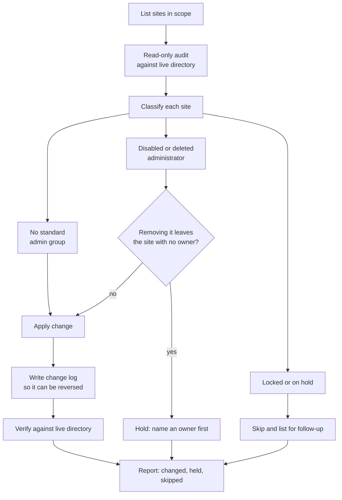

# 3. Permissions cleanup across 500+ SharePoint sites

[← All case studies](README.md)

**Role:** audited and ran the cleanup  ·  **Scale:** 500+ SharePoint Online sites  ·  **Status:** completed for the sites in scope; a group of sites is held for follow-up

## Problem
Over time, many SharePoint Online sites had accumulated administrators and owners who no longer worked there (disabled or deleted accounts), and there was no standard admin group across sites. That made access reviews slow and left some sites without an active owner.

## What I did
- **Audited first, read-only,** against live directory data rather than an old export, so decisions used who is actually enabled today.
- Added a **standard administrator group** to the sites and removed disabled or deleted accounts as administrators and owners.
- **Never left a site without an owner:** where removing a disabled owner would have left none, I held that site and flagged it for a named owner first.
- Wrote a **change log for every action**, so any change could be reversed.
- Left alone the few sites that were locked or deliberately held, and listed them for follow-up.

*Illustrative workflow showing the order of checks and the safety rule. Not a copy of any tool.*

## Engineering decisions
| Decision | Why |
|---|---|
| Audit against the live directory, not an export | Exports can mislabel who is still enabled |
| Hold any site that would be left with no owner | An ownerless site is a bigger problem than a disabled owner |
| Log every change with its previous value | So any single change can be reversed |
| Leave locked or held sites alone | They were not mine to change without asking |

## Risk and validation
The audit was read-only and was checked against live sign-in data before changes were made. The change log is the rollback, and results were checked against the live directory afterwards.

## Result
- The standard admin group was added, and disabled or deleted administrators were removed, across the 500+ sites in scope.
- Disabled owners were removed on all but a very small number of sites.
- Roughly a quarter of the sites were held, because removing their disabled owner would have left no owner. Those need named owners before they can be finished.

## Limitations
The held sites and the few locked sites are not fixed by this work and need follow-up. The standard admin group only covers the sites it was added to.

## What I'd improve
- Agree the list of named owners **before** starting, so fewer sites need to be held.
- Turn the audit into a scheduled report, so the problem is caught as it appears, not once a year.
