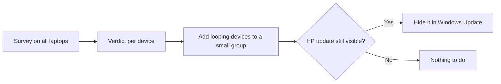

# 7. Stopping a repeating HP driver update with Intune remediations

[← All case studies](README.md)

**Role:** investigated, designed, built and tested it, with AI assistance for code drafts  ·  **Scale:** a small number of affected laptops, survey across the Lenovo laptop fleet  ·  **Status:** in progress, one step still unproven
**Skills:** PowerShell · Intune Remediations · Windows Update API · Entra ID groups · troubleshooting  ·  **Reading time:** about 2 minutes

## Problem
A few laptops showed a daily update popup and a long "Working on updates" screen at restart. It looked like a failing Windows update, but it wasn't. Windows Update kept offering the same HP printer driver (a USB driver from 2019). The install failed with error `0x80246007`, then reported success, then the same driver returned about every six days. A newer copy of the driver was already installed, so the repeated offer did nothing useful. It is a known HP and Windows Update issue and I found no published root cause.

## What I did
- Read each laptop's Windows Update history and found the same HP driver failing on a six-day cycle, while no other update was failing.
- Wrote a **survey** as a detection-only Intune remediation. It reports one verdict per device: looping, pending, hidden, past failures or clean. It changes nothing.
- Wrote a **hide** remediation that hides only those HP driver updates in Windows Update, the same as Microsoft's "Show or hide updates" tool.
- Assigned the survey broadly and the hide only to a small group of affected devices.

*Illustrative flow, not a copy of the scripts.*

## Engineering decisions
| Decision | Why |
|---|---|
| Hide the updates instead of using the Intune setting that excludes Windows Update drivers | That setting blocks every driver update and could break things that work today |
| Match only the two known HP driver titles | A broad HP match could hide a driver someone needs |
| Survey first, fix on a small group second | Shows how many devices are really affected before changing anything |
| Detection that never triggers a fix on a timeout | A slow Windows Update search must not cause a change |

## Risk and validation
- Tested the survey on one looping laptop and one already-hidden laptop.
- Tested the hide as the SYSTEM account on one laptop: three visible updates became hidden, and Intune then ran both scripts after a forced sync.
- Hiding is reversible: set the update back to visible.

## Result
- The survey gives a per-device verdict for the fleet.
- The hide worked on the first test laptop.

## Limitations
- **Not yet proven:** that Intune runs the hide on a laptop where the updates are still visible. The test laptop was already hidden, so the fix was skipped there. The next laptop added to the group will confirm it.
- It hides the symptom. It doesn't fix the cause on HP's or Microsoft's side.
- Setting the hide only works as SYSTEM on the device, so it can't be pushed over remote PowerShell.

## What I'd improve
- Confirm the run on a still-visible laptop, then publish a short help-desk article.
- Add affected devices to the group automatically from the survey result.

*Scripts: [HP-Driver-Update-Loop](https://github.com/Cyb3rAvi/infrastructure-automation-toolkit/tree/main/Intune/HP-Driver-Update-Loop) in the toolkit.*

*Details are generalised. No employer names, systems or data are shown.*

*Last reviewed: November 2026*
